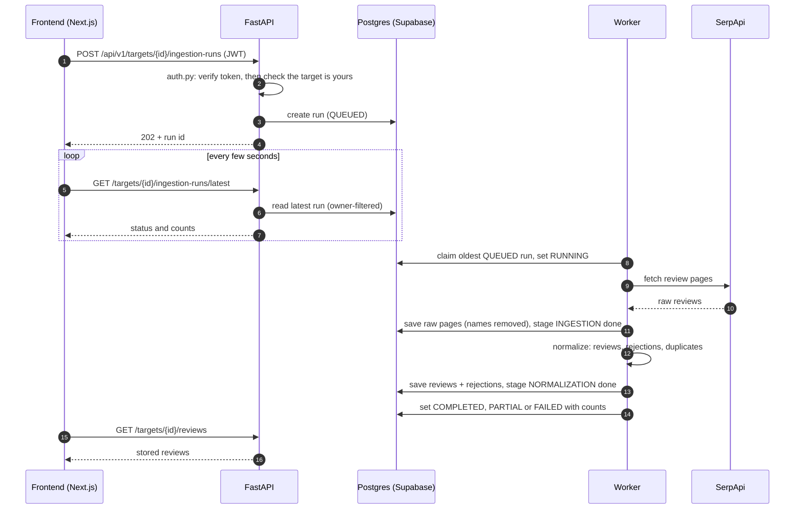
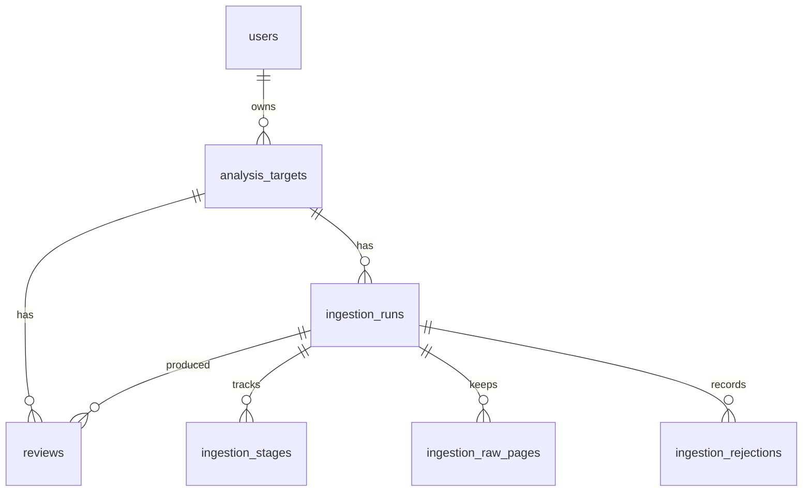

# Architecture

The Sprint 1 architecture baseline for ReviewLens AI (Tech Spec §2.1), plus an index of the design notes in this folder. It describes what is built on `dev` today. Items not decided yet are marked **Not decided**.

## 1. Diagram

How one review collection moves through the system. Solid arrows are requests, dotted arrows are replies.



The API never calls SerpApi. It only queues a run, and the worker does the fetching, so a slow or failing source never blocks a request. Sign-in is handled by Supabase Auth: the frontend gets a JWT from it, and the backend verifies that token against Supabase's public keys (JWKS). The LLM provider (Sprint 2) is not drawn because it is not decided.

## 2. The eleven baseline items

| # | Item | Choice | Notes |
|---|---|---|---|
| 1 | Frontend | Next.js 16, React 19, Tailwind 4 | `frontend/`. Pages call the backend through `frontend/src/lib/api.ts`. |
| 2 | Backend | FastAPI (Python 3.12), managed with `uv` | `backend/app/`. Layers: `api` → `repositories` → database; `services` for logic; `adapters` for outside services. |
| 3 | Database | Supabase Postgres | Schema in `supabase/migrations/`. Row level security is on with no policies, and the Data API roles are revoked, so the database is only reachable through our backend. |
| 4 | Identity provider | Supabase Auth | The frontend signs users in. The backend checks every token (RS256/ES256, audience, issuer, expiry) and takes the user id only from it. |
| 5 | Review ingestion | SerpApi Google Maps reviews, run by a background worker | One run per target at a time. Stages: INGESTION, then NORMALIZATION. See [019-ingestion-pipeline.md](019-ingestion-pipeline.md) and [review-ingestion.md](review-ingestion.md). |
| 6 | LLM provider | **Not decided** | Needed for Sprint 2. It sits behind one backend boundary (`backend/app/llm/`), and summary numbers come from stored data, not from the model. The Q&A flow and its test harness are in [qa-harness.md](qa-harness.md). |
| 7 | Deployment | **Not decided** (README mentions Vercel for the frontend and Render for the backend) | Sprint 3. CI today: GitHub Actions runs `scripts/check.sh` against a Postgres 17 service. |
| 8 | Domain entities | See section 3 | |
| 9 | API boundaries | See section 4 | |
| 10 | Screens | See section 5 | |
| 11 | Diagram | Section 1 | |

## 3. Data model

Seven tables in the `public` schema, created by the files in `supabase/migrations/`. Users come from Supabase Auth (`auth.users`); a trigger copies each new user into `public.users`.



How to read the tables below: **PK** primary key, **FK** foreign key, **null** may be empty. Every id is a `uuid` generated by the database. Deleting a user deletes their targets, and deleting a target deletes its runs, reviews and everything under them.

### `users`

One row per Supabase Auth user.

| Column | Type | Notes |
|---|---|---|
| `id` | uuid | PK, FK to `auth.users`, deleted with it |
| `email` | text | null |
| `created_at` | timestamptz | default now |

### `analysis_targets`

A place a user wants analysed.

| Column | Type | Notes |
|---|---|---|
| `id` | uuid | PK |
| `owner_id` | uuid | FK to `users`, required. Every query filters on it |
| `name` | text | Must contain at least one non-space character |
| `platform` | text | Required, not blank |
| `source_url` | text | The Maps link the user pasted. Required |
| `source_place_id` | text | null. The provider's id for the place, filled in at the first run |
| `source_metadata` | jsonb | null. Must be an object |
| `created_at`, `updated_at` | timestamptz | `updated_at` is set by a trigger |

Rule: one user cannot have the same place twice. `(owner_id, platform, source_place_id)` is unique once the place id is known.

### `ingestion_runs`

One attempt to collect a target's reviews.

| Column | Type | Notes |
|---|---|---|
| `id` | uuid | PK |
| `target_id` | uuid | FK to `analysis_targets` |
| `job_type` | enum | `INGESTION` (default) or `ENRICHMENT` |
| `status` | enum | `QUEUED` (default), `RUNNING`, `COMPLETED`, `PARTIAL`, `FAILED` |
| `queued_at` | timestamptz | When the run was created |
| `started_at` | timestamptz | null until a worker picks it up |
| `finished_at` | timestamptz | null until the run ends |
| `updated_at` | timestamptz | Set by a trigger |
| `reviews_ingested`, `reviews_rejected`, `reviews_duplicate` | integer | Counts, default 0, never negative |
| `error_code` | text | null unless the run failed |
| `source_metadata` | jsonb | null. Must be an object |

Rules the database enforces:
- Only one active run per target: a unique index over `QUEUED` and `RUNNING`. A second start returns 409.
- `error_code` is set exactly when the status is `FAILED`.
- `finished_at` is set exactly when the status is `COMPLETED`, `PARTIAL` or `FAILED`.
- A `RUNNING`, `COMPLETED` or `PARTIAL` run has a `started_at`.
- A finished ingestion run cannot say `COMPLETED` or `PARTIAL` with zero reviews, so a failure is never recorded as a success.
- `(id, target_id)` is unique, so a review can only point at a run of its own target.

### `ingestion_stages`

Progress inside a run, so a retry skips finished stages.

| Column | Type | Notes |
|---|---|---|
| `id` | uuid | PK |
| `run_id` | uuid | FK to `ingestion_runs` |
| `stage` | enum | `INGESTION`, `NORMALIZATION`, `ENRICHMENT` |
| `status` | enum | `PENDING` (default), `RUNNING`, `COMPLETED`, `FAILED` |
| `error_code` | text | Set exactly when the status is `FAILED` |
| `created_at`, `updated_at` | timestamptz | |

Rule: one row per stage per run, `(run_id, stage)` is unique.

### `ingestion_raw_pages`

The provider's pages after reviewer names, links, photos and owner replies are removed. They let a run be re-normalized without calling the provider again.

| Column | Type | Notes |
|---|---|---|
| `id` | uuid | PK |
| `run_id` | uuid | FK to `ingestion_runs` |
| `page_number` | integer | 1 or more |
| `payload` | jsonb | Must be an object. Already scrubbed |
| `next_page_token` | text | null. Where the next page starts |
| `created_at` | timestamptz | |

Rule: `(run_id, page_number)` is unique, so saving the same page twice cannot duplicate it.

### `reviews`

Normalized reviews. No reviewer name is stored.

| Column | Type | Notes |
|---|---|---|
| `id` | uuid | PK |
| `target_id` | uuid | FK to `analysis_targets` |
| `run_id` | uuid | FK, with `target_id`, to `ingestion_runs (id, target_id)` |
| `rating` | smallint | 1 to 5 |
| `review_text` | text | Required, not blank |
| `reviewed_at` | timestamptz | null. When the review was written |
| `source_review_id` | text | null. The provider's id, used to skip repeats |
| `source_url` | text | null |
| `source_metadata` | jsonb | Default `{}` |
| `mapping_version` | text | Required. Which version of the field mapping produced the row |
| `created_at` | timestamptz | |
| `search_vector` | tsvector | Generated from `review_text`, with a GIN index. Keyword search for the Q&A tools (S2-010). Postgres keeps it up to date; nothing writes it |

Rule: `(target_id, source_review_id)` is unique, so a second run over the same reviews adds none twice.

The Q&A tools (S2-010) read `reviews` live and store nothing of their own: counts, averages and terms are calculated each time, so they always match the summary card.

### `ingestion_rejections`

Provider records that could not become a review, kept with the reason.

| Column | Type | Notes |
|---|---|---|
| `id` | uuid | PK |
| `run_id` | uuid | FK to `ingestion_runs` |
| `reason` | text | Required, not blank |
| `raw_record` | jsonb | null. The record as received |
| `created_at` | timestamptz | |

### Access

Row level security is on for all seven tables with no policies, and `anon` and `authenticated` have no grants. Nothing reaches these tables except through our backend, which connects directly and checks ownership itself. See [012-cross-user-authorization.md](012-cross-user-authorization.md).

## 4. API boundaries

Every `/api/v1` route requires a verified user. A target that belongs to someone else returns 404, never 403. Only `/health` is public.

| Route | Purpose |
|---|---|
| `GET /health` | Liveness check |
| `GET /api/v1/me` | The signed-in user |
| `GET /api/v1/targets`, `POST /api/v1/targets` | List and create targets |
| `GET /api/v1/targets/{id}`, `DELETE /api/v1/targets/{id}` | Read and delete one target |
| `GET /api/v1/targets/{id}/reviews` | The target's stored reviews |
| `POST /api/v1/targets/{id}/ingestion-runs` | Queue a collection run (202) |
| `GET /api/v1/targets/{id}/ingestion-runs/latest` | Latest run status, polled by the workspace |

Ownership is enforced in the repository SQL (`WHERE owner_id = …`), not only in the route. The design is in [012-cross-user-authorization.md](012-cross-user-authorization.md).

## 5. Screens

| Screen | Path | Purpose |
|---|---|---|
| Home | `/` | Redirects to `/dashboard` |
| Login | `/login` | One page, switches between sign in and sign up. There is no separate `/signup` or `/reset-password` page yet, although the route guard lists both as public |
| Dashboard | `/dashboard` | Shows who is signed in, links to the targets, and signs out |
| Targets | `/targets` | The user's targets |
| New target | `/targets/new` | Create a target from a Maps link |
| Workspace | `/targets/[id]` | Start a run, watch its status, see failures and reviews |

## 6. Repository layout

What is on `dev` today. Naming and style rules are in [Coding Standards](../standards/coding-standards.md).

```
review-lens-ai/
├── frontend/
│   └── src/
│       ├── app/              # Next.js pages and layouts (login, dashboard, targets, workspace)
│       ├── lib/              # API client, Supabase client, helpers (with their tests)
│       └── proxy.ts          # Redirects signed-out users to /login
├── backend/
│   ├── app/
│   │   ├── main.py           # FastAPI entry point
│   │   ├── auth.py           # Verifies the Supabase token; the only source of the user id
│   │   ├── worker.py         # Background worker entry point
│   │   ├── platforms.py      # Checks and reads the Maps link
│   │   ├── core/             # Settings (config.py) and error handling
│   │   ├── api/              # HTTP routes
│   │   ├── schemas/          # Request and response shapes
│   │   ├── repositories/     # All SQL, owner-filtered
│   │   ├── services/         # Processing logic (normalizer); qa/orchestration and qa/tools/ is what the Q&A model can call
│   │   ├── llm/              # The model boundary (ModelClient); no provider yet
│   │   ├── adapters/serpapi/ # Talks to SerpApi
│   │   ├── fixtures/         # Saved provider responses, so tests never call the live service
│   │   └── db/               # Migration runner
│   └── tests/                # api, auth, db (needs Postgres), unit
├── supabase/migrations/      # Versioned SQL
├── docs/
│   ├── architecture/         # This folder
│   └── standards/            # Coding, philosophy, AI-assisted development, guardrails, UI/UX
├── scripts/                  # setup.sh, dev.sh, check.sh, migrate.sh, embed-reviews.sh, setup-branch-protection.sh
├── .github/                  # CI workflow, PR template
└── README.md
```

The session transcripts live at the repository root in `ai-transcripts/` (added by S1-004), not inside `backend/`.

## 7. Decisions in this folder

| Document | Covers |
|---|---|
| [012-cross-user-authorization.md](012-cross-user-authorization.md) | How a user is identified and why other users' data is invisible |
| [019-ingestion-pipeline.md](019-ingestion-pipeline.md) | How a run moves from QUEUED to a result (still marked Draft) |
| [review-ingestion.md](review-ingestion.md) | Why SerpApi, the worker's steps and rules, and the adapter that fetches Google Maps reviews |
| [qa-harness.md](qa-harness.md) | How a question reaches the model, the answer contract, and the deterministic test harness (S2-003) |

## 8. Keeping this current

Change this file in the same PR as any change to a technology above, a table or an API route. Fill in the two **Not decided** rows when the choice is made. Significant changes from this baseline should say why in the PR.
