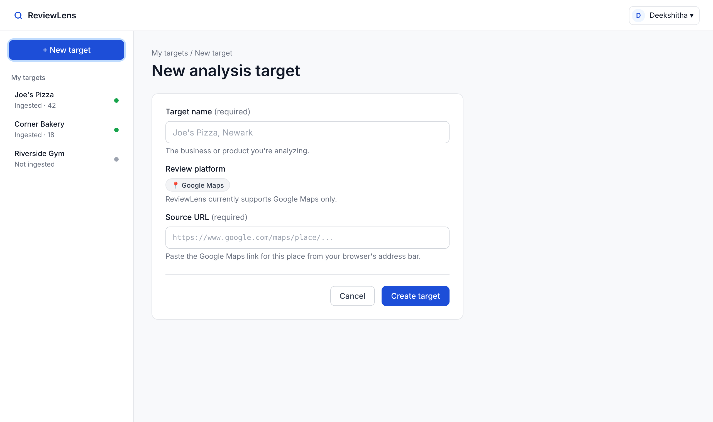
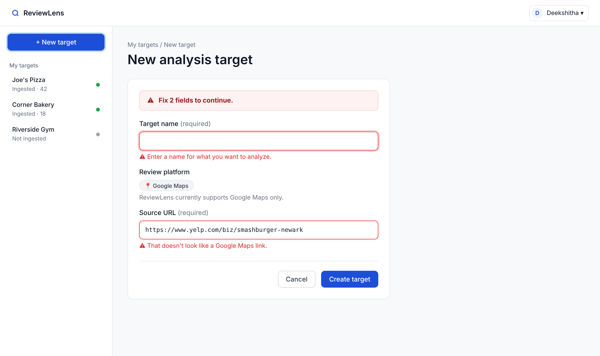
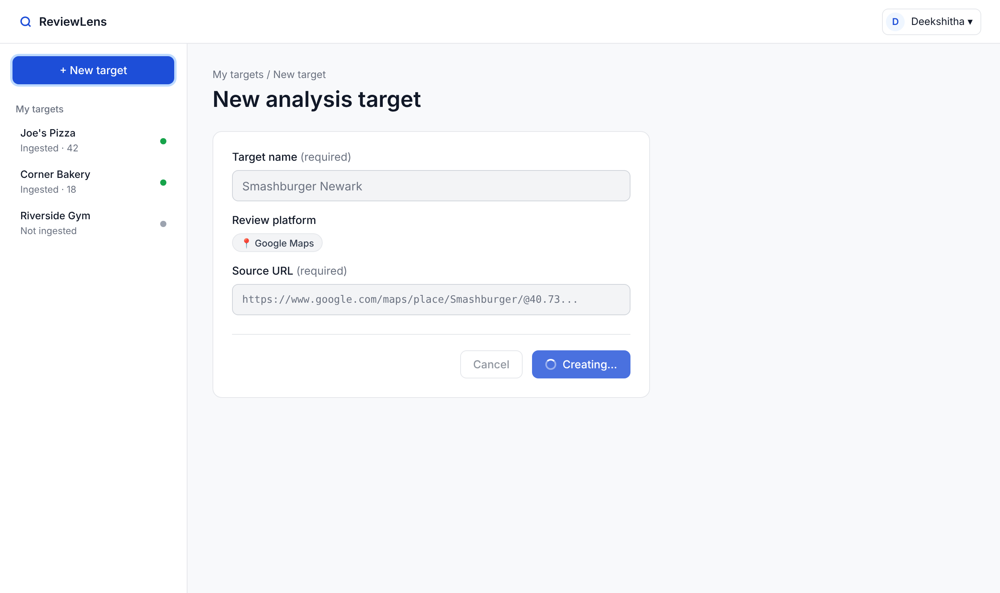
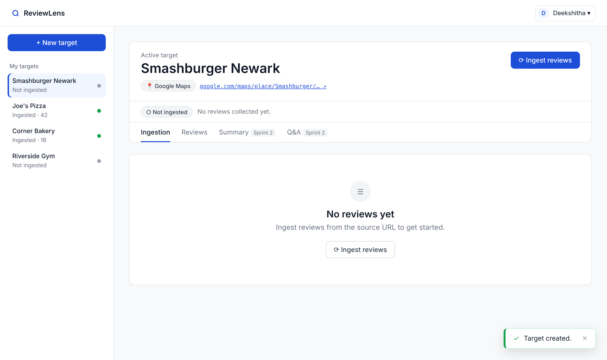
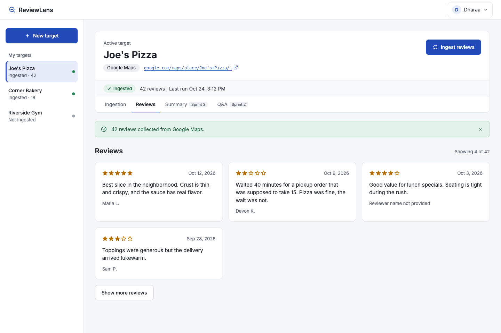
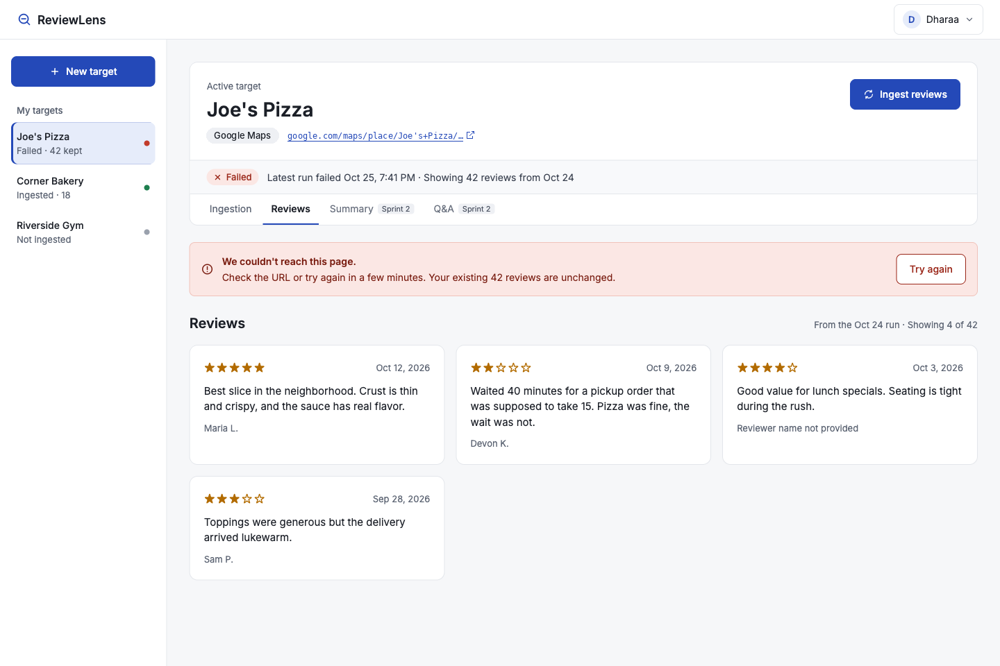

# ReviewLens UI/UX Standards

**Story:** S1-002 — Create UI/UX Standards Context Document
**Rules:** S1-BR-003, S1-BR-015, S1-BR-025
**Audience:** Every developer on the team, and any AI coding tool (Claude Code, Cursor, Copilot, etc.) generating frontend code.

> **For AI coding tools:** Read this file before creating or changing any page, component, form, or user-facing message. Reuse the components in §8 instead of creating new ones. If a pattern you need is not covered here, follow the closest existing pattern and flag it in the PR.

---

## 1. Core principle

ReviewLens is one product, not a set of sprint demos. Every screen must answer three questions without the user having to guess:

1. **Which AnalysisTarget is active?**
2. **What review data exists for it, and is it usable?**
3. **What just happened, and what can I do next?**

The main flow, which all navigation and layout should support:

Target list → Create / open target → Ingest reviews → Summary (Sprint 2) → Q&A (Sprint 2)

ReviewLens is a focused review-analysis tool. Nothing in the UI should make it look like a general-purpose chatbot.

---

## 2. Application navigation

**Pattern: left sidebar + top bar.** Used on every authenticated page. Do not introduce a different navigation style on any page.

### Top bar (always visible when signed in)

- Left: ReviewLens logo/name → links to the target list.
- Right: user menu (account name, sign out).

### Left sidebar

- **"+ New target"** button at the top (primary action).
- **"My targets"** list: target name + platform badge for each. The active target is highlighted.
- Collapses to an icon/hamburger below 1024px wide (see §11).

### Routes

| Route | Page | Auth required |
|---|---|---|
| `/` | Landing page | No |
| `/login` | Google sign-in (Supabase) | No |
| `/dashboard` | Signed-in home, redirects to `/targets` | Yes |
| `/targets` | Target list | Yes |
| `/targets/new` | Create target | Yes |
| `/targets/:id` | Target workspace | Yes |

### Rules

- Any unauthenticated visit to a protected route redirects to `/login`, then returns the user to the page they wanted after sign-in (S1-BR-003).
- A target the user does not own (or that doesn't exist) shows the **Not found** state (§6.3). Do not reveal whether the target exists for another user.
- After sign-out, redirect to `/login`. Pressing Back must not show protected data (S1-BR-006).
- The frontend redirect is a convenience only. The backend is what actually blocks access.

---

## 3. Page layout

All authenticated pages use the same shell:

```
┌──────────────────────────────────────────────────────────┐
│ Top bar: ReviewLens                            [User ▾]  │
├────────────┬─────────────────────────────────────────────┤
│ + New      │ Page header (title + primary action)        │
│   target   ├─────────────────────────────────────────────┤
│            │                                             │
│ My targets │ Page content                                │
│ • Target A │ (max width 1200px, left-aligned)            │
│ • Target B │                                             │
│            │                                             │
└────────────┴─────────────────────────────────────────────┘
```

- Sidebar width: 240px. Content padding: 32px desktop, 16px mobile.
- Every page has a **page header**: an H1 title on the left, the page's single primary action on the right (if there is one).
- One primary action per view. Everything else is secondary.

### 3.1 Target workspace (most important screen)

The workspace always starts with a **context header** that stays visible on every tab:

```
┌─────────────────────────────────────────────────────────┐
│ Joe's Pizza                            [Ingest reviews] │
│ [Google Maps]  source: maps.google.com/… ↗              │
│ Status: ● Ingested — 42 reviews · Oct 24, 3:12 PM       │
├─────────────────────────────────────────────────────────┤
│ Ingestion │ Reviews │ Summary* │ Q&A*                   │
└─────────────────────────────────────────────────────────┘
 * Sprint 2 tabs. Do not build them in Sprint 1.
```

The context header must show (S1-018):

- Target name (H1)
- Platform badge
- Source URL (shortened, opens in a new tab, full URL on hover)
- Current ingestion status badge (§7) with review count and last run time
- The ingest action

**Rule:** No workspace content, including future Q&A answers, may appear without this header above it. This is how the user always knows which target is active.

---

## 4. Spacing and typography

### Spacing

Use only this 4px-based scale. No one-off values like `13px`.

| Token | px | Use |
|---|---|---|
| space-1 | 4 | Icon-to-text gap |
| space-2 | 8 | Between related items (label → input) |
| space-3 | 12 | Inside badges, small buttons |
| space-4 | 16 | Between form fields; card padding (mobile) |
| space-6 | 24 | Card padding (desktop); between cards |
| space-8 | 32 | Page padding; between page sections |

### Typography

One font family: **Geist** (already loaded by Next.js; fallback: system sans-serif). **Geist Mono** only for URLs and IDs.

| Style | Size/Weight | Use |
|---|---|---|
| H1 | 28px/600 | Page title, target name |
| H2 | 20px/600 | Section headings, card titles |
| Body | 15px/400 | Default text |
| Small | 13px/400 | Helper text, timestamps, metadata |
| Label | 14px/500 | Form labels, table headers |

- Sentence case everywhere ("Create target", not "Create Target").
- Never use more than two text sizes inside a single card.

### Color

Define these as tokens (CSS variables or Tailwind theme). Never hard-code hex values in components.

| Token | Tailwind | Use |
|---|---|---|
| `primary` | blue-700 | Primary buttons, links, active nav item |
| `neutral-*` | gray-50 to gray-900 | Text (gray-900), secondary text (gray-500), borders (gray-200), backgrounds (gray-50) |
| `success` | green-600 | Ingestion succeeded |
| `warning` | amber-500 | Partial success (Sprint 2) |
| `danger` | red-600 | Errors, failed ingestion, destructive actions |
| `info` | sky-600 | Processing state, neutral notices |

- Color must never be the only signal. Every status also has a text label and/or icon.
- Text must meet WCAG AA contrast (4.5:1 for body text).

---

## 5. Buttons and actions

| Variant | Look | Use | Limit |
|---|---|---|---|
| **Primary** | Filled `primary` | The main action on a view (Create target, Ingest reviews) | One per view |
| **Secondary** | Outlined | Alternatives (Cancel, Retry) | — |
| **Ghost / link** | Text only | Low-emphasis actions (View source) | — |
| **Danger** | Filled `danger` | Destructive actions (Delete target) | Always needs confirmation |

### Rules

- Labels are **verb + noun**: "Create target", "Ingest reviews", "Delete target". Never "Submit", "OK", or "Go".
- While an action is running: the button is disabled, shows a spinner, and its label changes ("Creating…", "Ingesting…"). This prevents double submits.
- Destructive actions open a confirmation dialog that names the thing being deleted: "Delete *Joe's Pizza*? This removes the target and its 42 reviews."
- Button order in forms and dialogs: Secondary (Cancel) on the left, Primary on the right.
- Every action must be reachable by keyboard and show a visible focus ring.

---

## 6. Forms, validation, and errors

### 6.1 Form conventions

- Labels sit **above** inputs. Never use placeholder text as the label.
- Required fields are marked with "(required)" in the label text, not just an asterisk.
- Helper text under an input explains the expected format *before* the user makes a mistake.
- The primary button is always enabled; validation runs on submit. Fields also re-validate on blur after the first submit attempt.

**Create target form (S1-015, S1-016):**

| Field | Type | Helper text |
|---|---|---|
| Target name (required) | Text | "The business or product you're analyzing." |
| Review platform | Read-only badge showing Google Maps | "ReviewLens currently supports Google Maps only." |
| Source URL (required) | URL | "Paste the Google Maps link for this place from your browser's address bar." |

### 6.2 Validation display (S1-BR-015)

- Errors appear **inline under the field**, in `danger` color with an icon.
- If there are errors, show a summary at the top of the form ("Fix 2 fields to continue") and move keyboard focus to the first invalid field.
- Frontend validation is for speed. The backend validates again and is authoritative. Backend validation errors must map onto the same field-level display. The backend should return errors keyed by field name.
- A rejected form creates **nothing**. The user stays on the form with their input preserved.

**Standard validation messages** (reuse this wording; it matches the backend):

| Case | Message |
|---|---|
| Missing name | Enter a name for what you want to analyze. |
| Name too long | Keep the name under 200 characters. |
| Missing URL | Enter the link to the place's Google Maps page. |
| Not https | Enter a full link starting with https:// |
| Contains spaces | That link contains spaces. Paste it exactly as copied. |
| Not a Google Maps link | That doesn't look like a Google Maps link. |

### 6.3 Error presentation (S1-BR-025)

Errors are written for an average user. **Never** show stack traces, database errors, HTTP client errors, provider SDK messages, auth-provider internals, or API keys. Log those on the server instead.

Every error message has two parts: **what happened** + **what to do next**.

| Error type | Where it appears | Example message |
|---|---|---|
| Validation | Inline under the field | See §6.2 |
| Session expired / signed out | Redirect to `/login` + toast | "Your session ended. Sign in again to continue." |
| Not found / not yours | Full-page empty state | "We couldn't find that target. It may have been deleted, or you may not have access." + [Back to my targets] |
| Ingestion: source unreachable | Status banner in workspace | "We couldn't reach this page. Check the URL or try again in a few minutes." |
| Ingestion: no reviews found | Status banner in workspace | "This page didn't return any reviews. Make sure it's a Google Maps page with reviews." |
| Ingestion: provider quota hit | Status banner in workspace | "Review collection is temporarily unavailable. Try again later." |
| Ingestion: timeout | Status banner in workspace | "Collecting reviews took too long. Try again." |
| Unexpected error | Toast | "Something went wrong on our side. Try again, and let the team know if it keeps happening." |

- Authorization denial and "not found" look **identical** to the user, so they can't tell whether another user's target exists.
- A failed action never clears the user's input or existing data.

---

## 7. Loading, processing, and status states

### 7.1 Loading data

- **Page or list loading:** skeleton placeholders in the shape of the content (not a full-page spinner).
- **Button actions:** inline spinner in the button (§5).
- If loading takes longer than ~10 seconds, show a message: "Still working…".

### 7.2 Empty states

Every list or panel needs a designed empty state with a message and a next action.

| Where | Message | Action |
|---|---|---|
| No targets yet | "No targets yet. Create one to start analyzing reviews." | [+ New target] |
| Target with no ingestion | "No reviews yet. Ingest reviews from the source URL to get started." | [Ingest reviews] |

### 7.3 Ingestion status badge (S1-023)

One shared `StatusBadge` component. Same colors, icons, and wording everywhere: sidebar, target list, workspace header.

| State | Badge | Header detail line |
|---|---|---|
| Not started | ○ gray "Not ingested" | "No reviews collected yet." |
| Processing | ◐ info "Ingesting…" (animated) | "Collecting reviews from Google Maps. This can take up to a minute." |
| Succeeded | ● success "Ingested" | "42 reviews · Oct 24, 3:12 PM" |
| Failed | ✕ danger "Failed" | Error message from §6.3 + [Try again] |
| Partial *(only if the team supports it)* | ◑ warning "Partially ingested" | "38 reviews saved, 4 skipped." |

### Rules

- A failed run never looks like a success. If a previous run succeeded and a new one fails, show the failure banner **and** keep showing the previous reviews with their date ("Showing 42 reviews from Oct 24").
- Never display placeholder or sample reviews. If there is no data, show the empty state (S1-BR-024).
- The ingest button is disabled while a run is in progress.
- Detailed analytics (rating breakdowns, charts) are Sprint 2. Sprint 1 shows only status + count.

---

## 8. Reusable components

Build these once in the shared folder `frontend/src/app/_components/` (shadcn primitives in `_components/ui/`). File names are kebab-case and exports are PascalCase, e.g. `status-badge.tsx` exports `StatusBadge` (see [Coding Standards](coding-standards.md)). Pages must use them instead of making their own versions.

| Component | Purpose | Notes |
|---|---|---|
| `AppShell` | Top bar + sidebar + content area | Wraps every authenticated page |
| `PageHeader` | H1 + optional primary action | |
| `TargetContextHeader` | Name, platform, source, status, ingest action | Required at the top of the workspace |
| `Button` | Primary / Secondary / Ghost / Danger + loading state | |
| `TextField` | Label, input, helper text, inline error | Used for every text/URL input |
| `FormErrorSummary` | "Fix N fields" banner at the top of a form | |
| `StatusBadge` | Ingestion states from §7.3 | Single source of truth for status display |
| `PlatformBadge` | Shows Google Maps | |
| `Banner` | Inline success / error / info message inside a page | |
| `Toast` | Short-lived notification for background events | Auto-dismiss after 5s; errors stay until closed |
| `EmptyState` | Icon + message + action | |
| `Skeleton` | Loading placeholder | |
| `ConfirmDialog` | Destructive-action confirmation | Focus trapped; Esc cancels |
| `ReviewCard` | One review: rating, text, author/date if available | Long text truncates with "Show more" |

### Rules

- Before creating a component, check this list. If something similar exists, extend it with a prop instead of copying it.
- A new shared component must be added to this table in the same PR.
- Components take display text as props; they don't hard-code page-specific wording.

---

## 9. Feedback after actions

| Action | Feedback |
|---|---|
| Target created | Navigate to the new target's workspace + toast "Target created." |
| Ingestion started | Status badge changes to "Ingesting…" immediately |
| Ingestion succeeded | Badge → "Ingested", banner "42 reviews collected.", Reviews tab shows data |
| Ingestion failed | Badge → "Failed", danger banner with message + [Try again] |
| Target deleted | Navigate to target list + toast "Target deleted." |
| Signed out | Navigate to `/login` |

The user should never click a button and see nothing change.

---

## 10. Accessibility baseline

- Use real HTML elements: `<button>` for actions, `<a>` for navigation, `<label for>` on every input.
- All interactive elements reachable by Tab, in visual order, with a visible focus ring.
- Inline errors are linked to their input with `aria-describedby`; status changes use an `aria-live="polite"` region so screen readers announce them.
- Icons that carry meaning have text labels or `aria-label`.
- WCAG AA contrast for all text.

---

## 11. Responsive behavior

Desktop-first, but nothing should break on smaller screens.

| Width | Behavior |
|---|---|
| ≥ 1024px | Full layout: sidebar visible |
| 768–1023px | Sidebar collapses to a hamburger menu |
| < 768px | Single column; context header stacks vertically; tables become stacked cards |

The active target name and status must stay visible at every width.

---

## 12. Mockups

The mockups below show how the standards in this document apply to real screens. If a mockup and the text disagree, the text wins. Fix the mockup in the same PR.

### 12.1 Create target (S1-015, S1-016)

Route: `/targets/new`. Uses the standard app shell (§3). The "+ New target" sidebar button is shown as active.

Page header: H1 "New analysis target". No header action; the form owns the primary action.

Form card: max width 560px, left-aligned in the content area.

| Field | Input | Helper text |
|---|---|---|
| Target name (required) | Text. Placeholder: "Joe's Pizza, Newark" | The business or product you're analyzing. |
| Review platform | Read-only badge: "Google Maps" | ReviewLens currently supports Google Maps only. |
| Source URL (required) | URL, monospace. Placeholder: "https://www.google.com/maps/place/..." | Paste the Google Maps link for this place from your browser's address bar. |

Actions (bottom right of the form): Cancel (secondary, left), Create target (primary, right).

States shown:

1. **Empty:** the form with no input.
2. **Validation errors:** a danger banner at the top of the form reading "Fix 2 fields to continue." Each invalid field has a danger border and an inline error with an icon underneath it. The user's input is kept.
   - Name: "Enter a name for what you want to analyze."
   - Source URL: "That doesn't look like a Google Maps link."
3. **Submitting:** the button reads "Creating…" with a spinner. The button, Cancel and the fields are disabled until the request finishes.
4. **Success:** the user is taken to the new target's workspace (§3.1), which shows the "No reviews yet" empty state (§7.2), and a success toast reads "Target created." (§9).









### 12.2 Target workspace (S1-018, S1-023)

Shows the workspace in the "Ingested" state and in the "Failed" state with previous reviews kept (§7.3).




