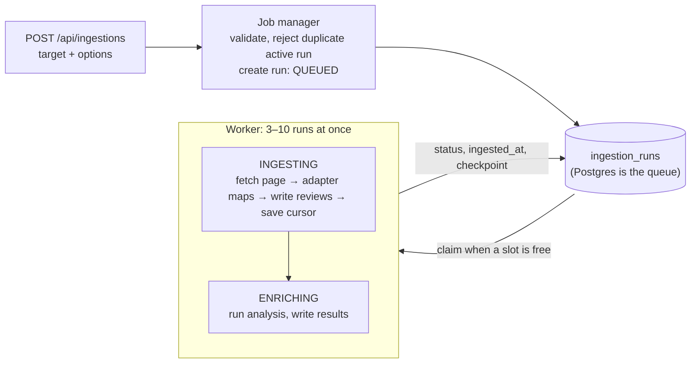
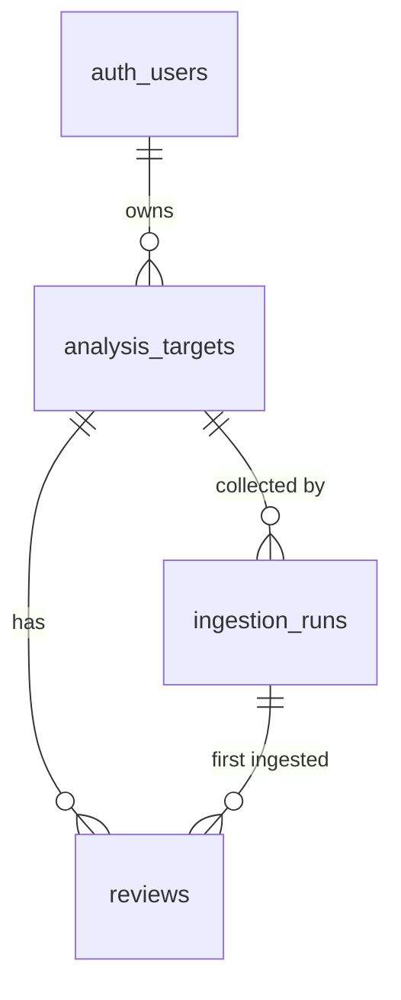

# Spike: SerpApi Google Maps reviews

> **AI-generated, unreviewed prototype.** Throwaway branch `spike/serpapi-sample-data`. Do not merge or build on this code.
> Its job is to answer one question: what data do we get, what does it cost, and what shape should we store?

## 1. How much data does one analysis need?

An analysis should replace about **3 hours** of an analyst reading reviews. Most reviews take ~5 s to read; important ones take up to ~60 s to record.

| Mix (quick / important) | Avg per review | Reviews in 3 h (10,800 s) |
|---|---|---|
| 100% / 0% | 5 s | 10,800 / 5 = **2,160** |
| 90% / 10% | 0.9 × 5 + 0.1 × 60 = 10.5 s | 10,800 / 10.5 ≈ **1,029** |
| 80% / 20% | 0.8 × 5 + 0.2 × 60 = 16 s | 10,800 / 16 = **675** |
| 0% / 100% | 60 s | 10,800 / 60 = **180** |

Target: **~1,000 reviews per analysis** (the 90/10 row).

## 2. What it costs

One SerpApi request = one page = one search credit. Page 1 of a sort returns 10 reviews; later pages return up to 20 (`num=20`).

Budget: 6 free keys × 250 searches = **1,500 searches / month**. Bottleneck is credits, not throughput (hourly limit is also 250 per key).

Because we look for pain points, each run spends its pages like this:

| Sort | Pages | Why |
|---|---|---|
| `ratingLow` | 25 | complaints = pain points |
| `newestFirst` | 20 | what is happening now; SerpApi's recommended sort for completeness |
| `qualityScore` | 5 | what Google ranks as most relevant |
| `ratingHigh` | 0 | praise is not what the analysis is for |

| Per run | Calculation | Result |
|---|---|---|
| Searches | 25 + 20 + 5 | **50** (20% of one key) |
| Reviews fetched | 3 first pages × 10 + 47 pages × 20 | **970** |
| Unique reviews | 970 × 81/90 (duplicate rate measured below) | **≈ 873** |
| Reviews with text | 873 × 73/81 (text rate measured below) | **≈ 787** |
| Analyst time replaced | 787 × 10.5 s / 3,600 | **≈ 2.3 h** |
| Runs per month | 1,500 / 50 | **30** |

The plan lands short of 3 h. The duplicate and text rates come from 2 pages per sort; at 25 pages they are unmeasured.

Fetching every review of a place costs `1 + ⌈(total − 10) / 20⌉` searches. Gregorys Coffee (1,518 reviews): 1 + ⌈1,508 / 20⌉ = **77**.

## 3. What SerpApi actually returned

From [fetch_raw_pages.py](fetch_raw_pages.py): Gregorys Coffee, 2 pages per sort, 6 credits.

| Observation | Measured |
|---|---|
| Page sizes | page 1 = 10, page 2 = 20, for every sort (the scraper README says page 1 = 8) |
| Overlap between sorts | 90 fetched, **81 unique** (qualityScore∩ratingLow 6, newestFirst∩qualityScore 2, newestFirst∩ratingLow 1) |
| `ratingLow` pages 1–2 | all 30 reviews are 1-star |
| Reviews without text | 8 / 81 |
| `place_info`, `topics` | **page 1 only**; absent on page 2 |
| `user.local_guide` | 51 / 81; missing instead of `false` |
| `details` | 69 / 81; keys vary per review; values mix numbers (`food: 1`) and free text, which can itself be a complaint |
| `images` | 27 / 81 |
| `position` | restarts at 1 on every page, so it is not an ID |
| `next_page_token` | ends in `:10`, `:30`; looks like an offset (observation only) |

SerpApi's [release notes](https://serpapi.com/google-maps-reviews-api/release-notes) show pagination breaking repeatedly (fixes in Aug 2025, Mar/Jun/Aug 2026) and four issues open as of Oct 20–22, 2026: missing pagination, missing reviews, timeouts, odd `local_guide` values. **Ingestion must expect partial results.**

## 4. Architecture

A run moves through two stages, **ingesting** (fetch + map + write) then **enriching**:



### Design decisions

| Decision | Why |
|---|---|
| **Schema on write**: the adapter maps each page; only canonical rows are stored, no raw responses | Raw pages hold reviewer names (see §5). The mapping must be right the first time; re-fetching costs credits. |
| Ingestion and normalization are one `INGESTING` stage | Mapping happens before the write, so there is nothing to checkpoint in between. |
| One `status` column plus an `ingested_at` timestamp | `ingested_at` set = ingestion durably done. A `FAILED` run with it empty failed in ingestion; with it set, in enrichment. |
| The `ingestion_runs` table is the queue, claimed with `FOR UPDATE SKIP LOCKED` | One worker process is enough; credits cap volume long before workers do. |
| Each target owns its reviews | The spec requires ownership to flow through the target. Two users analyzing the same place each spend credits. |

### Worker

The worker pulls work; nothing pushes to it. It never claims more runs than it has free slots.

```
slots = Semaphore(MAX_RUNS)                 # 3–10

loop:
    acquire a slot
    run = claim_next_queued_run()           # UPDATE ... SET status = 'INGESTING'
                                            #   WHERE id = (SELECT id FROM ingestion_runs
                                            #     WHERE status = 'QUEUED' ORDER BY created_at
                                            #     FOR UPDATE SKIP LOCKED LIMIT 1)
    if no run: release slot, wait for NOTIFY or poll
    else: start process_run(run), release slot when it ends

process_run(run):
    try:
        if run.ingested_at is null:
            ingest(run)                     # resumes from run.checkpoint
            run.ingested_at = now()
        run.status = 'ENRICHING'
        enrich(run)
        run.status = 'COMPLETED'
    except error:
        run.status = 'FAILED', run.error = error   # retry = set back to QUEUED
```

### Ingestion with buggy pagination

The checkpoint is the cursor per sort. It is written in the same transaction as that page's reviews, so a crash never skips or double-counts a page.

```
ingest(run):
    for sort_by, max_pages in SORT_PLAN:
        state = run.checkpoint[sort_by] or {token: null, pages_done: 0, done: false}
        seen = set()

        while not state.done and state.pages_done < max_pages:
            page = fetch_with_retry(target, sort_by, state.token)   # 3 tries, backoff
            rows, skipped = adapter.map_review(r) for r in page     # drops names, skips no-text
            done = no next_token
                or page has 0 reviews
                or next_token == state.token
                or every review on the page is already in `seen`

            in one transaction:
                upsert rows on (target_id, source_review_id)
                run.reviews_ingested += new rows, run.reviews_failed += skipped
                state = {token: page.next_token, pages_done: state.pages_done + 1, done: done}
                run.checkpoint[sort_by] = state
            seen += page review ids

    planned vs fetched pages goes into run.source_metadata, so a partial run is visible
```

## 5. Mapping SerpApi → `reviews`

Rule: **store no names.** Text inside reviews may still contain names; a cleansing step can be added later.

| SerpApi field | Stored as | Kept? |
|---|---|---|
| `review_id` | `source_review_id` | ✔ dedupe key |
| `snippet` | `content` | ✔ review without text is skipped and counted in `reviews_failed` |
| `rating` | `rating` (+ `rating_scale` = 5) | ✔ |
| `iso_date` | `published_at` | ✔ |
| `link` | `source_url` | ✔ for the analyst to open the original. The page it opens shows the reviewer's name, so it is never passed to the LLM. |
| `iso_date_of_last_edit`, `likes`, `details` | `source_metadata` | ✔ |
| `user.local_guide`, `user.reviews`, `user.photos` | `source_metadata` | ✔ no identity |
| `user.name`, `user.link`, `user.thumbnail` | — | ✘ names / identity |
| `user.contributor_id` | — | ✘ identifies a person |
| `images` | — | ✘ can show people |
| `response` (owner reply) | — | ✘ addresses the reviewer by name |
| `extracted_snippet` | — | ✘ same text as `snippet` in this run (see §8) |
| `position`, `date` ("2 weeks ago"), `source` | — | ✘ not an ID / relative / always "Google" |

Per place, not per review (page 1 only) → `analysis_targets`:

| SerpApi field | Stored as |
|---|---|
| `search_parameters.data_id` | `source_ref` |
| `search_metadata.google_maps_reviews_url` | `source_url` |
| `place_info.title`, `.address`, `.type`, `.rating`, `.reviews` | `source_metadata` (`provider_name`, `address`, `category`, `provider_rating`, `provider_review_count`) |
| `topics` | `source_metadata.topics`, a hint only. Enrichment generates its own topics, so CSV targets get them too. |

The target row is created when the user submits: owner, platform, `source_ref`, and a `name` the user types. Ingestion never changes `name`; the provider's own name goes to `source_metadata.provider_name`. Each ingestion run overwrites `source_metadata` from page 1, so the target holds the latest snapshot; older topic counts are not kept.

## 6. Data model

Assignment minimum: **User, AnalysisTarget, IngestionRun, Review**. Ownership is transitive: runs and reviews are reachable only through a target the user owns.



**`auth.users`**: Supabase built-in. We reference `id` (uuid, PK) only.

**`analysis_targets`**

| Column | Type | Req | Key / constraint |
|---|---|---|---|
| `id` | uuid | ✔ | PK |
| `owner_id` | uuid | ✔ | FK → `auth.users.id` |
| `name` | text | ✔ | |
| `platform` | text | ✔ | CHECK in (`google_maps`, `csv`) |
| `source_ref` | text | ✔ | UNIQUE (`owner_id`, `platform`, `source_ref`); SerpApi `data_id`, or CSV file hash |
| `source_url` | text | | |
| `source_metadata` | jsonb | ✔ | default `{}` |
| `created_at` | timestamptz | ✔ | |

**`ingestion_runs`**

| Column | Type | Req | Key / constraint |
|---|---|---|---|
| `id` | uuid | ✔ | PK |
| `target_id` | uuid | ✔ | FK → `analysis_targets.id`, ON DELETE CASCADE |
| `status` | text | ✔ | CHECK in (`QUEUED`, `INGESTING`, `ENRICHING`, `COMPLETED`, `FAILED`); partial UNIQUE (`target_id`) while not `COMPLETED`/`FAILED` |
| `ingested_at` | timestamptz | | set only after all ingestion writes succeed |
| `checkpoint` | jsonb | ✔ | default `{}`; `{"ratingLow": {"token": "…", "pages_done": 12, "done": false}}` |
| `source_metadata` | jsonb | ✔ | default `{}`; user options (incl. CSV mapping), sort plan, `hl`, `num`, pages planned/fetched |
| `reviews_ingested` | int | ✔ | default 0 |
| `reviews_failed` | int | ✔ | default 0 |
| `error` | jsonb | | |
| `started_at`, `completed_at` | timestamptz | | |
| `created_at`, `updated_at` | timestamptz | ✔ | |

**`reviews`**

| Column | Type | Req | Key / constraint |
|---|---|---|---|
| `id` | uuid | ✔ | PK; what enrichment results will reference |
| `target_id` | uuid | ✔ | FK → `analysis_targets.id`, ON DELETE CASCADE |
| `ingestion_run_id` | uuid | ✔ | FK → `ingestion_runs.id` (first run that saw it) |
| `source_review_id` | text | ✔ | UNIQUE (`target_id`, `source_review_id`); provider ID, or hash of content + date |
| `content` | text | ✔ | |
| `rating` | numeric | | CHECK set together with `rating_scale`, 0 ≤ `rating` ≤ `rating_scale` |
| `rating_scale` | numeric | | |
| `published_at` | timestamptz | | |
| `source_url` | text | | |
| `source_metadata` | jsonb | ✔ | default `{}` |
| `mapping_version` | text | ✔ | e.g. `serpapi@1` |
| `created_at` | timestamptz | ✔ | |

`id` is ours and new on every insert, so it cannot tell that two sorts returned the same review. `source_review_id` can.

**Compatibility rules**
- Required = what every source can provide. Everything else is nullable or lives in `source_metadata`.
- A provider field goes into `source_metadata` first; it becomes a column once two platforms have it.
- `platform` and `status` are text + CHECK, so adding a value is a one-line change.
- `mapping_version` records which mapping wrote each row.
- Optional, not included: `chat_sessions`, `chat_messages`.

## 7. Adapters

Each platform gets one adapter behind the same interface. Only the adapter knows the provider's shape.

```
ReviewAdapter
    mapping_version                          # "serpapi@1", "csv@1"
    pages(target, plan, checkpoint)          # yields (page, next_cursor); resumes from checkpoint
    map_target(page) -> target fields        # page 1 only
    map_review(item) -> row | skip reason    # schema on write
```

**CSV** is just another adapter. Users are not experts, so they map, we validate:

1. Read headers; suggest a mapping (`review_text` → `content`, `stars` → `rating`).
2. User confirms. Only `content` is required. If they map `rating`, ask for the scale.
3. Preview ~10 mapped rows.
4. Ingest; report `reviews_ingested` / `reviews_failed` with reasons.
5. The mapping is saved in `ingestion_runs.source_metadata`. Without an ID column, `source_review_id` = hash of content + date.

## 8. Not verified

- Unique yield and text rate at 25 pages per sort (measured only at 2).
- Whether `review_id` stays stable across fetches over time.
- Whether `next_page_token` expires, which limits how late a resume can happen.
- Whether `place_id` and `data_id` return the same results for one place.
- Whether storing reviewer names is barred by Google's or SerpApi's terms (we drop them regardless), and whether SerpApi allows pooling 6 free accounts.
- Which text to store when `hl` triggers a translation (`snippet` vs `extracted_snippet.original` / `.translated`). In this run all three were identical.

## Running the scripts

All need only `python3`. Output goes to `output/`, which is **committed** so the team can read the data shape without running anything. Before committing, [redact_output.py](redact_output.py) replaced reviewer identities in `output/raw/` and `output/merged_sample.json` with stable fakes (`Reviewer 01`, example.com links), so the shape is unchanged. Names a reviewer writes inside their own review text are not redacted. **If you re-fetch, run `redact_output.py` before committing.**

**API key:** the fetch scripts read it from the `SERPAPI_API_KEY` environment variable only. They do not read `backend/.env` or any other file, and refuse to run without it. Get the key from your SerpApi dashboard. Free usage checks (searches left, hourly limit): `https://serpapi.com/account.json?api_key=...` costs no credit.

| Script | Output | Credits |
|---|---|---|
| [fetch_raw_pages.py](fetch_raw_pages.py) | `output/raw/<sort>/page_<n>.json` untouched bodies (committed copies redacted) + `manifest.json` (params, cursors, search id) | 6 |
| [map_to_reviews.py](map_to_reviews.py) | `output/canonical/`: **the end-product shape**, a pair of files (see below) | 0 |
| [redact_output.py](redact_output.py) | rewrites `output/raw/` + `merged_sample.json` in place with fake reviewer identities | 0 |
| [fetch_sample_reviews.py](fetch_sample_reviews.py) | `output/merged_sample.json`, **merged, not raw, not the end product**; its `_about` block lists the assumptions | 3 |

```bash
SERPAPI_API_KEY=... python3 spikes/serpapi-reviews/fetch_raw_pages.py [data_id]
python3 spikes/serpapi-reviews/map_to_reviews.py
```

The canonical output is **one pair per target**, one file per table. Read them together:

```
output/canonical/
├── analysis_target.json   1 row   { "id": "example-target-id", "name": "example name entered by user", ..., topics }
└── reviews.json           N rows  { "target_id": "example-target-id", "content": ..., "rating": ... }
                                      └── FK → analysis_target.json "id"   (analysis_targets 1:N reviews)
```

`example-target-id` is a placeholder for the uuid the database generates, and `name` for what the user types at submit. Place-level data (address, rating, review count, topics) is only in `analysis_target.json`; review-level data is only in `reviews.json`.

`map_to_reviews.py` is the mapping half of the SerpApi adapter only. It lists every SerpApi review field as mapped or dropped and prints any it does not recognize, so a new field is noticed instead of lost. On this run: 90 raw → 73 written, 9 duplicates across sorts, 8 skipped (no text), 0 unrecognized fields.

Shared request code: [serpapi_client.py](serpapi_client.py).
